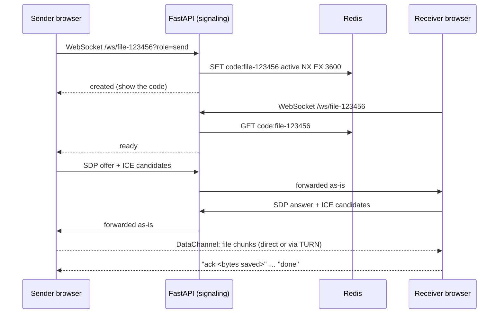

# P2P File Share

**Send files of any size from one device to another, across the internet, with a 6-digit code: no accounts, no uploads, no installs.**

Open the page on two devices, on the same Wi-Fi or on opposite sides of the world, and the file streams from one browser to the other over an encrypted WebRTC connection. The server only introduces the two browsers to each other and never sees the file. The receiver gets an ordinary download in the browser's download bar, written to disk as it arrives, so memory use stays flat whether the file is 1 MB or 200 GB.


---

## Features

- **Truly peer-to-peer, over any network.** Sender and receiver can be on different devices, networks and countries. File data never touches the server. WebRTC encrypts it end to end (DTLS), even when it goes through a TURN relay.
- **No file size limit.** The app imposes no cap: 100 GB or 200 GB files work, limited only by the receiver's free disk space and a stable connection (see [Large files](#large-files-100-gb)). Verified with files up to **50 GB**, with the receiver's memory staying flat at around 400–570 MB.
- **Native downloads.** A service worker turns the incoming stream into a normal browser download, with the browser's own progress bar, time remaining, and pause/resume.
- **Multiple files and folders.** Selecting several files, or a whole folder with **Choose folder**, sends them as one `.zip` (a folder keeps its name and subfolders), built on the fly while sending. Nothing is buffered, files over 4 GB use ZIP64, and the files are stored uncompressed, so the exact size is known up front.
- **Backpressure all the way to disk.** The sender stays at most 64 MB ahead of what the receiver has actually saved, so a slow disk or a paused download never runs anyone out of memory.
- **Works across networks.** STUN for direct connections and Metered TURN as a relay fallback for strict NATs. ICE restarts automatically when a phone switches between Wi-Fi and 4G.
- **Short-lived codes.** A code is valid only while the sender keeps the page open, for at most 1 hour. Expired codes are never reused, and users get distinct messages for an expired code and a mistyped one.
- **Graceful fallbacks.** If the service worker can't stream (for example Safari), the receiver falls back to the native save dialog, then to the browser's private storage (OPFS).

## How it works



1. **Signaling.** The 6-digit code names a WebSocket room. FastAPI relays the WebRTC handshake (SDP offer/answer and ICE candidates) between the two browsers, and Redis tracks whether each code is active or expired.
2. **Connection.** The browsers use STUN to discover their public addresses and connect directly. If a firewall blocks that, Metered's TURN server relays the encrypted traffic.
3. **Transfer.** The sender streams the file in 64 KB chunks. The receiver writes it to disk in 8 MB batches and acknowledges each write, and the sender throttles itself against those acknowledgements.
4. **Download.** The page passes a `ReadableStream` to a service worker, which serves it as a download response. The browser's download manager writes it to disk.

For a full walkthrough of every component, see **[EXPLANATION.md](EXPLANATION.md)**.

## Tech stack

| Layer | Technology |
|---|---|
| Backend | Python 3.12, FastAPI, WebSockets, Uvicorn |
| State | Redis 7 (code lifecycle, TTLs) |
| Frontend | Vanilla JavaScript, WebRTC DataChannel, Service Worker, Streams API, File System Access API, OPFS |
| Networking | STUN (Google, Cloudflare), TURN ([Metered](https://www.metered.ca/)) |
| Deployment | [Render](https://render.com/) + Upstash Redis in production ([DEPLOY.md](DEPLOY.md)); Docker Compose + Cloudflare Tunnel locally |
| Testing | Playwright (Chrome, Edge, Firefox), Python |

## Getting started

### Prerequisites

- [Docker Desktop](https://www.docker.com/products/docker-desktop/)
- A free [Metered](https://www.metered.ca/) account for TURN (20 GB/month, no card). This is optional: without it, only direct connections work.

### Setup

```bash
git clone https://github.com/KrBeTect2025/peer.git
cd peer
cp .env.example .env    # then set METERED_TURN_URL to your Metered credentials URL
```

### Run

```bash
docker compose up -d --build
curl http://127.0.0.1:20241/quicktunnel    # prints the public https://xxxx.trycloudflare.com link
```

This starts three containers:

| Service | Role |
|---|---|
| `web` | FastAPI: serves the page, the ICE config, and WebSocket signaling (`127.0.0.1:8000`) |
| `redis` | Tracks which codes are active or expired |
| `tunnel` | Cloudflare quick tunnel: a public HTTPS link to `web`, with no port forwarding needed |

> The quick-tunnel link changes each time the `tunnel` container restarts. Run the `curl` above again to get the new one.

### Without Docker

```bash
pip install -r requirements.txt
docker compose up -d redis           # or any Redis on localhost:6379
uvicorn main:app --port 8000
```

Open `http://localhost:8000`. Browsers allow WebRTC and service workers on `localhost`; any other host needs HTTPS.

### Configuration

| Variable | Default | Description |
|---|---|---|
| `METERED_TURN_URL` | (unset) | Metered credentials URL (`…/api/v1/turn/credentials?apiKey=…`). If unset, only STUN is used. |
| `REDIS_URL` | `redis://localhost:6379/0` | Redis connection string (`rediss://` for TLS, e.g. Upstash) |
| `CODE_TTL` | `3600` | How long a code stays valid, in seconds |
| `VT_API_KEY` | (unset) | VirusTotal API key for the hash lookup ([Safety checks](#safety-checks)). If unset, the panel says "Hash check unavailable". |
| `PORT` | `8000` | Port the Docker image listens on (set by hosts like Render) |

## Deploying

The production setup is one container on **Render**, with **Upstash** for Redis and **Metered** for TURN, all on free plans. Render builds the `Dockerfile` from GitHub using [`render.yaml`](render.yaml) and serves the app over HTTPS. On the free plan the server sleeps after 15 minutes with no open pages, and the next visitor waits about a minute. See **[DEPLOY.md](DEPLOY.md)** for the step-by-step setup and the checks to run afterwards.

## Usage

1. **Sender (any device):** open the app, choose one or more files. A 6-digit code appears. Keep the page open until the transfer finishes.
2. **Receiver (any other device, any network):** open the same app link, enter the code and press **Receive**. The download starts immediately in the browser's download bar.
3. The same code can serve more receivers, one at a time, for up to an hour while the sender keeps the page open.

## Large files (100 GB+)

There is no size cap in the app: the file is streamed straight to the receiver's disk, never held in memory, and multi-file zips switch to ZIP64 past 4 GB. Practical limits for very large transfers:

| Factor | What it means |
|---|---|
| **Receiver's free disk space** | The only hard limit (Chrome, Edge, Firefox). |
| **Connection stability** | A transfer cannot resume after a long drop: it starts over. Short network blips are retried automatically. Keep both devices plugged in with sleep turned off. |
| **Speed** | Set by the slower of the two connections. At 10 MB/s, 100 GB takes about 3 hours; at 3 MB/s, about 9. Both pages must stay open the whole time. |
| **TURN relay quota** | Direct connections use no relay. If the networks force a relay, data counts against the Metered quota (20 GB/month on the free plan), so very large relayed transfers need a paid plan or your own TURN server. |
| **Safari fallback** | Saves into the browser's site storage first, which the browser limits per site, so very large files need Chrome, Edge or Firefox on the receiving side. |
| **1-hour code expiry** | Doesn't cut off a running transfer: after an hour no new receiver can join, but the current one finishes. |

## Safety checks

The receiver sees a safety panel for every file, with two checks. Neither one uploads the file anywhere.

| Check | How | When the result shows |
|---|---|---|
| **File type** | The first 16 bytes ("magic bytes") show the real type, which is compared with the file name (`static/filetype.js`). Warns on programs, a type that doesn't match the name (a program named `photo.jpg`), double extensions such as `invoice.pdf.exe`, script extensions (`.bat`, `.ps1`, `.vbs`, `.js`, `.sh`, ...) and reversed-text characters in the name. | Within the first chunk, so in the first second, even for a huge file |
| **Malware database** | The receiver's browser computes the file's SHA-256 chunk by chunk while it arrives. Only that 64-character hash is sent to `POST /scan/hash`, and the server asks VirusTotal whether the hash belongs to known malware. | When the last byte is in |

The panel's color is the worse of the two results: red (danger), orange (be careful), green (no problems found) or grey (not verified). A warning never blocks the download.

What these checks **cannot** do:

- **The hash lookup only catches known malware.** It finds files someone has already uploaded to VirusTotal and engines have flagged. New, modified or targeted malware comes back "not in the database", which does **not** mean safe. Most files people make themselves also come back "not in the database".
- **The file-type check catches disguised files, not threats in general.** A real PDF, Office document or ZIP can still carry something harmful. A ZIP's contents are not checked, and files sent as several files or a folder arrive as one zip built during the transfer, so their hash is always new and always "not in the database".
- **The results come after the file is saved.** Files are written to disk as they arrive (that is how 200 GB works with flat memory), so the hash result shows once the download is done. If it says malicious, delete the file without opening it. The type warning usually shows long before a large file finishes.
- **The hash is not fully private.** For a file that is already public, its hash identifies it. The Peer server and VirusTotal learn that your IP checked that exact file.
- **The free VirusTotal key is small and not for commercial use.** It allows 4 lookups a minute and 500 a day for the whole site. When that runs out, receivers see "Hash check unavailable". Results are cached for an hour, and each IP is limited to 4 lookups a minute and 40 a day so one person can't use up the quota. A paid VirusTotal plan is needed for commercial use.

To turn the hash lookup on, set `VT_API_KEY` (a free key from your VirusTotal account). Without it everything else works and the panel says "Hash check unavailable".

## Project structure

```
├── main.py                 # entry point: uvicorn main:app
├── config.py               # loads .env
├── core/server.py          # FastAPI app + static files
├── routers/
│   ├── pages.py            # index page, /sw.js (served from root for full scope), /healthz
│   ├── ice.py              # GET /config: STUN/TURN servers (keeps the API key server-side)
│   ├── scan.py             # POST /scan/hash: cache + per-IP limit around the VirusTotal lookup
│   └── signaling.py        # WS /ws/{room}: code lifecycle + message relay
├── services/
│   ├── rooms.py            # in-memory room → sockets map
│   ├── turn.py             # Metered credential fetch with 1-hour cache
│   └── virustotal.py       # hash → malicious / suspicious / clean / unknown / error
├── db/client.py            # Redis client, CODE_TTL
├── static/
│   ├── index.html          # UI
│   ├── app.js              # WebRTC, flow control, sinks, retries
│   ├── sw.js               # service worker: stream → browser download
│   ├── filetype.js         # magic-byte file-type check (safety panel)
│   ├── vendor/             # hash-wasm 4.12.0 SHA-256 (MIT): hashes the file chunk by chunk
│   └── zip.js              # streaming ZIP/ZIP64 writer for multi-file sends
├── tests/                  # Playwright browser tests, code-lifecycle and zip tests, REPORT.md
├── Dockerfile              # production image (also used by docker compose)
├── docker-compose.yml      # local stack: app + Redis + Cloudflare quick tunnel
├── render.yaml             # Render Blueprint: the production service
└── DEPLOY.md               # Render + Upstash deployment guide
```

## Testing

The app was tested end to end in real Chrome, Edge and Firefox, both locally and over the public Cloudflare link. Every transfer was checked to be byte-identical (SHA-1). Highlights:

| Scenario | Result |
|---|---|
| 50 GB single file | ✅ Identical, receiver memory ~422 MB |
| 3 GB through the download bar | ✅ 14.6 min, peak 568 MB |
| Chrome → Edge, Chrome → Firefox | ✅ |
| 0-byte files, Unicode names, `.html` files (never rendered) | ✅ |
| Sender closes tab mid-transfer / receiver cancels | ✅ Clear message on both sides, no stuck downloads |
| No service worker / Safari-style stream failure | ✅ Falls back to the save dialog |
| Multi-file and folder zip (4, 300 and 65,536 files, nested paths, two receivers at once, out-of-order reads), verified by Python's `zipfile` | ✅ |

Testing and code review found seven bugs, all fixed, including a race condition that only appeared over the public internet. See **[tests/REPORT.md](tests/REPORT.md)** for the full report, methodology and known gaps.

```bash
cd tests && npm i
node browser.test.mjs basic edge firefox zero unicode html second multi senderdrop cancel nosw dataclone
node zip.test.mjs
python check_codes.py ws://127.0.0.1:8000
```

Safety checks (no network needed: VirusTotal is mocked and never called for real):

```bash
pip install -r requirements.txt -r requirements-dev.txt
python -m pytest tests                  # POST /scan/hash
node --test tests/filetype.test.mjs     # file-type check
```

For one real end-to-end check, send the [EICAR test file](https://www.eicar.org/download-anti-malware-testfile/) with `VT_API_KEY` set: it is a harmless file every antivirus flags on purpose, so the panel should say malicious. Your own antivirus may delete it before it is sent.

## Limitations

- **No resume after a dropped connection.** A broken transfer starts over, which matters most for 100 GB+ files.
- **Single server instance.** Live WebSocket rooms are held in memory, so the app runs as one Uvicorn worker. Scaling out would need a shared pub/sub layer, such as Redis channels.
- **Not tested on Safari or mobile devices.** Safari's stream behaviour is simulated in tests.
- **Throughput depends on the network path.** Relayed (TURN) transfers count against the Metered quota.
- **The safety checks are not a virus scan.** See [Safety checks](#safety-checks) for exactly what they catch and miss.
