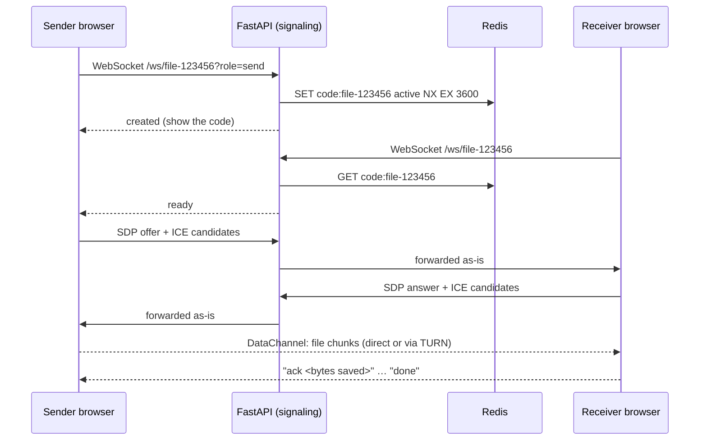

# P2P File Share

**Send files of any size from one device to another, across the internet, with a 6-digit code: no accounts, no uploads, no installs.**

Open the page on two devices, on the same Wi-Fi or on opposite sides of the world, and the file streams from one browser to the other over an encrypted WebRTC connection. The server only introduces the two browsers to each other and never sees the file. The receiver gets an ordinary download in the browser's download bar, written to disk as it arrives, so memory use stays flat whether the file is 1 MB or 200 GB.


---

## Features

- **Truly peer-to-peer, over any network.** Sender and receiver can be on different devices, networks and countries. File data never touches the server. WebRTC encrypts it end to end (DTLS), even when it goes through a TURN relay.
- **No file size limit.** The app imposes no cap: 100 GB or 200 GB files work, limited only by the receiver's free disk space and a stable connection (see [Large files](#large-files-100-gb)). Verified with files up to **50 GB**, with the receiver's memory staying flat at around 400–570 MB.
- **Native downloads.** A service worker turns the incoming stream into a normal browser download, with the browser's own progress bar, time remaining, and pause/resume.
- **Multiple files.** Selecting several files sends them as one `.zip`, built on the fly while sending. Nothing is buffered, files over 4 GB use ZIP64, and the files are stored uncompressed, so the exact size is known up front.
- **Backpressure all the way to disk.** The sender stays at most 64 MB ahead of what the receiver has actually saved, so a slow disk or a paused download never runs anyone out of memory.
- **Works across networks.** STUN for direct connections and Metered TURN as a relay fallback for strict NATs. ICE restarts automatically when a phone switches between Wi-Fi and 4G.
- **Short-lived codes.** A code is valid only while the sender keeps the page open, for at most 1 hour. Expired codes are never reused, and users get distinct messages for an expired code and a mistyped one.
- **Graceful fallbacks.** If the service worker can't stream (for example Safari), the receiver falls back to the native save dialog, then to the browser's private storage (OPFS).

## How it works



1. **Signaling.** The 6-digit code names a WebSocket room. FastAPI relays the WebRTC handshake (SDP offer/answer and ICE candidates) between the two browsers, and Redis tracks whether each code is active or expired.
2. **Connection.** The browsers use STUN to discover their public addresses and connect directly. If a firewall blocks that, Metered's TURN server relays the encrypted traffic.
3. **Transfer.** The sender streams the file in 64 KB chunks. The receiver writes it to disk in 8 MB batches and acknowledges each write, and the sender throttles itself against those acknowledgements.
4. **Download.** The page passes a `ReadableStream` to a service worker, which serves it as a download response. The browser's download manager writes it to disk.

For a full walkthrough of every component, see **[EXPLANATION.md](EXPLANATION.md)**.

### Knowledge graph

The codebase is mapped as a knowledge graph with [graphify](https://github.com/Graphify-Labs/graphify): 213 nodes, 374 edges and 12 communities (signaling, client WebRTC, service worker download, tests, and more).

- **[GRAPH_REPORT.md](graphify-out/GRAPH_REPORT.md)**: core abstractions, communities and surprising connections.
- **[graph.html](graphify-out/graph.html)**: interactive graph. Download it and open it in a browser, since GitHub shows HTML as source.

## Tech stack

| Layer | Technology |
|---|---|
| Backend | Python 3.12, FastAPI, WebSockets, Uvicorn |
| State | Redis 7 (code lifecycle, TTLs) |
| Frontend | Vanilla JavaScript, WebRTC DataChannel, Service Worker, Streams API, File System Access API, OPFS |
| Networking | STUN (Google, Cloudflare), TURN ([Metered](https://www.metered.ca/)) |
| Deployment | Docker Compose, Cloudflare Tunnel (public HTTPS) |
| Testing | Playwright (Chrome, Edge, Firefox), Python |

## Getting started

### Prerequisites

- [Docker Desktop](https://www.docker.com/products/docker-desktop/)
- A free [Metered](https://www.metered.ca/) account for TURN (20 GB/month, no card). This is optional: without it, only direct connections work.

### Setup

```bash
git clone https://github.com/KrBeTect2025/peer-peer.git
cd peer-peer
cp .env.example .env    # then set METERED_TURN_URL to your Metered credentials URL
```

### Run

```bash
docker compose up -d --build
curl http://127.0.0.1:20241/quicktunnel    # prints the public https://xxxx.trycloudflare.com link
```

This starts three containers:

| Service | Role |
|---|---|
| `web` | FastAPI: serves the page, the ICE config, and WebSocket signaling (`127.0.0.1:8000`) |
| `redis` | Tracks which codes are active or expired |
| `tunnel` | Cloudflare quick tunnel: a public HTTPS link to `web`, with no port forwarding needed |

> The quick-tunnel link changes each time the `tunnel` container restarts. Run the `curl` above again to get the new one.

### Without Docker

```bash
pip install -r requirements.txt
docker compose up -d redis           # or any Redis on localhost:6379
uvicorn main:app --port 8000
```

Open `http://localhost:8000`. Browsers allow WebRTC and service workers on `localhost`; any other host needs HTTPS.

### Configuration

| Variable | Default | Description |
|---|---|---|
| `METERED_TURN_URL` | (unset) | Metered credentials URL (`…/api/v1/turn/credentials?apiKey=…`). If unset, only STUN is used. |
| `REDIS_URL` | `redis://localhost:6379/0` | Redis connection string |
| `CODE_TTL` | `3600` | How long a code stays valid, in seconds |

## Usage

1. **Sender (any device):** open the app, choose one or more files. A 6-digit code appears. Keep the page open until the transfer finishes.
2. **Receiver (any other device, any network):** open the same app link, enter the code and press **Receive**. The download starts immediately in the browser's download bar.
3. The same code can serve more receivers, one at a time, for up to an hour while the sender keeps the page open.

## Large files (100 GB+)

There is no size cap in the app: the file is streamed straight to the receiver's disk, never held in memory, and multi-file zips switch to ZIP64 past 4 GB. Practical limits for very large transfers:

| Factor | What it means |
|---|---|
| **Receiver's free disk space** | The only hard limit (Chrome, Edge, Firefox). |
| **Connection stability** | A transfer cannot resume after a long drop: it starts over. Short network blips are retried automatically. Keep both devices plugged in with sleep turned off. |
| **Speed** | Set by the slower of the two connections. At 10 MB/s, 100 GB takes about 3 hours; at 3 MB/s, about 9. Both pages must stay open the whole time. |
| **TURN relay quota** | Direct connections use no relay. If the networks force a relay, data counts against the Metered quota (20 GB/month on the free plan), so very large relayed transfers need a paid plan or your own TURN server. |
| **Safari fallback** | Saves into the browser's site storage first, which the browser limits per site, so very large files need Chrome, Edge or Firefox on the receiving side. |
| **1-hour code expiry** | Doesn't cut off a running transfer: after an hour no new receiver can join, but the current one finishes. |

## Project structure

```
├── main.py                 # entry point: uvicorn main:app
├── config.py               # loads .env
├── core/server.py          # FastAPI app + static files
├── routers/
│   ├── pages.py            # index page and /sw.js (served from root for full scope)
│   ├── ice.py              # GET /config: STUN/TURN servers (keeps the API key server-side)
│   └── signaling.py        # WS /ws/{room}: code lifecycle + message relay
├── services/
│   ├── rooms.py            # in-memory room → sockets map
│   └── turn.py             # Metered credential fetch with 1-hour cache
├── db/client.py            # Redis client, CODE_TTL
├── static/
│   ├── index.html          # UI
│   ├── app.js              # WebRTC, flow control, sinks, retries
│   ├── sw.js               # service worker: stream → browser download
│   └── zip.js              # streaming ZIP/ZIP64 writer for multi-file sends
├── tests/                  # Playwright browser tests, code-lifecycle and zip tests, REPORT.md
├── graphify-out/           # knowledge graph: GRAPH_REPORT.md + interactive graph.html
├── Dockerfile
└── docker-compose.yml
```

## Testing

The app was tested end to end in real Chrome, Edge and Firefox, both locally and over the public Cloudflare link. Every transfer was checked to be byte-identical (SHA-1). Highlights:

| Scenario | Result |
|---|---|
| 50 GB single file | ✅ Identical, receiver memory ~422 MB |
| 3 GB through the download bar | ✅ 14.6 min, peak 568 MB |
| Chrome → Edge, Chrome → Firefox | ✅ |
| 0-byte files, Unicode names, `.html` files (never rendered) | ✅ |
| Sender closes tab mid-transfer / receiver cancels | ✅ Clear message on both sides, no stuck downloads |
| No service worker / Safari-style stream failure | ✅ Falls back to the save dialog |
| Multi-file zip (4 and 300 files), verified by Python's `zipfile` | ✅ |

Testing found five bugs, all fixed, including a race condition that only appeared over the public internet. See **[tests/REPORT.md](tests/REPORT.md)** for the full report, methodology and known gaps.

```bash
cd tests && npm i
node browser.test.mjs basic edge firefox zero unicode html second multi senderdrop cancel nosw dataclone
node zip.test.mjs
python check_codes.py ws://127.0.0.1:8000
```

## Limitations

- **No resume after a dropped connection.** A broken transfer starts over, which matters most for 100 GB+ files.
- **Single server instance.** Live WebSocket rooms are held in memory, so the app runs as one Uvicorn worker. Scaling out would need a shared pub/sub layer, such as Redis channels.
- **Not tested on Safari or mobile devices.** Safari's stream behaviour is simulated in tests.
- **Throughput depends on the network path.** Relayed (TURN) transfers count against the Metered quota.
